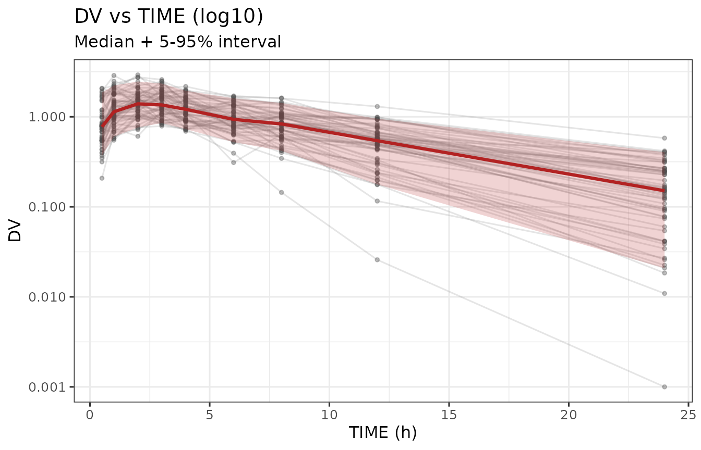
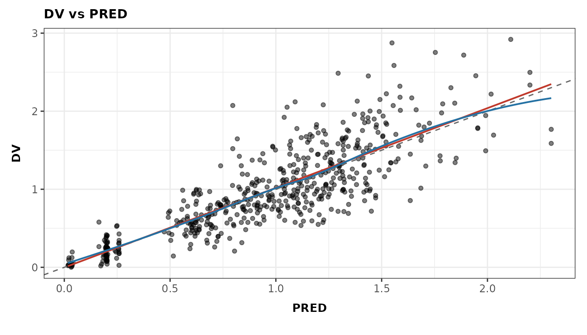
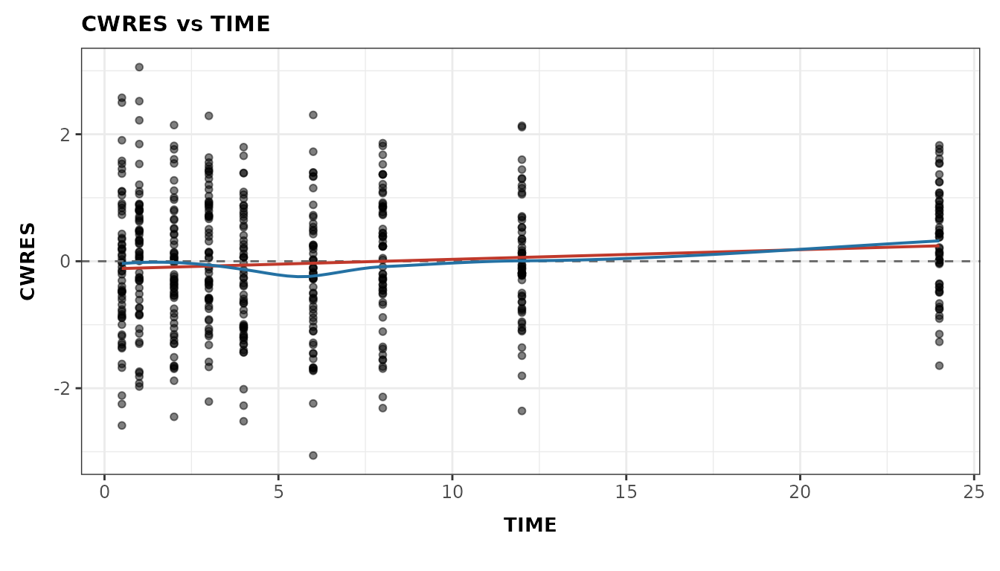

# Getting started with nmpilot

This vignette walks through a small popPK analysis with **nmpilot**,
from the data set and a first control stream to the comparison of two
models. NONMEM is not needed to read it: the package ships an example
project whose NONMEM runs have already been made. The chunks that call
NONMEM are shown but not run.

``` r

library(nmpilot)
ex <- system.file("extdata", "example", package = "nmpilot")
list.files(ex, recursive = TRUE)
#>  [1] "example_data.csv"   "README.txt"         "run1.ctl"          
#>  [4] "run1.reg/run1.cor"  "run1.reg/run1.cov"  "run1.reg/run1.ctl" 
#>  [7] "run1.reg/run1.ext"  "run1.reg/run1.lst"  "run1.reg/run1.phi" 
#> [10] "run1.reg/run1.shk"  "run1.reg/sdtab1"    "run2.ctl"          
#> [13] "run2.reg/run2.cor"  "run2.reg/run2.cov"  "run2.reg/run2.ctl" 
#> [16] "run2.reg/run2.ext"  "run2.reg/run2.lst"  "run2.reg/run2.phi" 
#> [19] "run2.reg/run2.shk"  "run2.reg/sdtab2"    "sim_example_data.R"
```

The data are **simulated** (60 fictitious subjects, single oral dose of
100 mg, 9 samples each, body weight `WT` and a binary genotype `GENO`;
see `README.txt` and `sim_example_data.R` in the example folder). Two
models were fitted with NONMEM 7.6:

- `run1`: one-compartment model with first-order absorption, no
  covariate (BASE);
- `run2`: same model with weight on CL (estimated exponent) and V
  (exponent fixed to 1), and genotype on CL (FINAL).

## 1. The data set

[`nm_read_csv()`](https://nskoch.github.io/nmpilot/reference/nm_read_csv.md)
reads a NONMEM data set, identifies the reserved columns and computes
the time after dose.
[`nm_summary()`](https://nskoch.github.io/nmpilot/reference/nm_summary.md)
gives a short diagnostic.

``` r

dat <- nm_read_csv(file.path(ex, "example_data.csv"))
#> === Identified NONMEM columns ===
#>   ID     -> ID
#>   DV     -> DV
#>   MDV    -> MDV
#>   TIME   -> TIME
#>   EVID   -> EVID
#>   AMT    -> AMT
#>   CMT    -> CMT
#> TIME format: numeric
#>   TAD computed (600 values).
nm_summary(dat$data)
#> === Diagnostic summary ===
#>   Subjects             : 60
#>   Records              : 600
#>   Observations         : 540
#>   TIME range           : 0.00 - 24.00 h
#>   Distinct doses       : 100
#>   Observation CMTs     : 1
```

``` r

nm_plot_dv(dat$data, scales = "log", verbose = FALSE)
```



## 2. Writing a control stream

[`nm_write_ctl()`](https://nskoch.github.io/nmpilot/reference/nm_write_ctl.md)
writes a first control stream from the columns of the data set: here a
one-compartment model with first-order absorption, as in `run1`, with a
combined error model. `$INPUT` follows the column order of the file, the
`#` of `#ID` becomes the `IGNORE` character, and the covariates are
written in a `cotab` table.

``` r

ctl <- nm_write_ctl(data = "../example_data.csv",
                    input = file.path(ex, "example_data.csv"),
                    error = "combined", theta_init = c(CL = 4, V = 40),
                    covariates = c("WT", "GENO"))
ctl
#> $PROBLEM 1cpt EV SUB/TRANS abs=first-order elim=linear
#> $INPUT ID TIME AMT DV EVID MDV CMT WT GENO
#> $DATA ../example_data.csv IGNORE=#
#> $SUBROUTINES ADVAN2 TRANS2
#> $PK
#> TVCL = THETA(1)
#> CL = TVCL*EXP(ETA(1))
#> TVV = THETA(2)
#> V = TVV*EXP(ETA(2))
#> TVKA = THETA(3)
#> KA = TVKA*EXP(ETA(3))
#> S2 = V   ; scale: concentration in the central compartment
#> 
#> $ERROR
#>   IPRED = F
#>   W     = SQRT(IPRED**2*SIGMA(1,1) + SIGMA(2,2))
#>   IF (W.EQ.0) W = 1
#>   IRES  = DV - IPRED
#>   IWRES = IRES/W
#>   Y     = IPRED + IPRED*ERR(1) + ERR(2)
#> 
#> $THETA ; initial estimates and bounds
#>   (0, 4)  ; CL
#>   (0, 40)  ; V
#>   (0, 1)  ; KA
#> 
#> $OMEGA 0.039 ; ETA(CL)
#> $OMEGA 0.039 ; ETA(V)
#> $OMEGA 0.086 ; ETA(KA)
#> 
#> $SIGMA 0.09 ; ERR(1) proportional
#> $SIGMA 0.01 ; ERR(2) additive
#> 
#> $ESTIMATION METHOD=COND INTERACTION MAXEVAL=9999 SIGDIGITS=3 PRINT=5
#> $COVARIANCE PRINT=E MATRIX=S
#> 
#> $TABLE ID TIME AMT EVID MDV CMT DV PRED IPRED RES IRES WRES IWRES CWRES NPDE ESAMPLE=300 SEED=12334 NOAPPEND NOPRINT ONEHEADER FILE=sdtab
#> $TABLE ID ETA1 ETA2 ETA3 FIRSTONLY NOPRINT NOAPPEND ONEHEADER FILE=patab
#> $TABLE ID WT GENO FIRSTONLY NOPRINT NOAPPEND ONEHEADER FILE=cotab
```

[`nm_ctl_check()`](https://nskoch.github.io/nmpilot/reference/nm_ctl_check.md)
looks for inconsistencies that can be seen without NM-TRAN, such as a
THETA, ETA or EPS used without a declaration. It also works on a control
stream written by hand:

``` r

nm_ctl_check(ctl)
#> [OK] Check - No obvious inconsistency found by the static checks.
nm_ctl_check(file.path(ex, "run1.ctl"))
#> [OK] Check - No obvious inconsistency found by the static checks.
```

Three functions transform a control stream:
[`nm_ctl_mu()`](https://nskoch.github.io/nmpilot/reference/nm_ctl_mu.md)
(MU referencing, for the EM and Bayesian methods),
[`nm_ctl_iov()`](https://nskoch.github.io/nmpilot/reference/nm_ctl_iov.md)
(inter-occasion variability) and
[`nm_ctl_m3()`](https://nskoch.github.io/nmpilot/reference/nm_ctl_m3.md)
(M3 method for data below the limit of quantification). With
`reference`,
[`nm_ctl_check()`](https://nskoch.github.io/nmpilot/reference/nm_ctl_check.md)
shows what changed:

``` r

mu <- nm_ctl_mu(ctl)
nm_ctl_check(mu, reference = ctl)
#> [OK] Check - No obvious inconsistency found by the static checks.
#> 
#> Differences from reference: 6 line(s) removed, 9 added
#> - TVCL = THETA(1)
#> - CL = TVCL*EXP(ETA(1))
#> - TVV = THETA(2)
#> - V = TVV*EXP(ETA(2))
#> - TVKA = THETA(3)
#> - KA = TVKA*EXP(ETA(3))
#> + ; MU referencing - former definition: TVCL = THETA(1)
#> + MU_1 = LOG(THETA(1))
#> + CL = EXP(MU_1 + ETA(1))
#> + ; MU referencing - former definition: TVV = THETA(2)
#> + MU_2 = LOG(THETA(2))
#> + V = EXP(MU_2 + ETA(2))
#> + ; MU referencing - former definition: TVKA = THETA(3)
#> + MU_3 = LOG(THETA(3))
#> + KA = EXP(MU_3 + ETA(3))
```

Use `output_file = "run3.ctl"` to write the result to disk.

## 3. Running NONMEM

[`nm_run()`](https://nskoch.github.io/nmpilot/reference/nm_run.md) calls
the `nmfe` launcher directly (no PsN, no Wings for NONMEM). By default
each run gets its own `<run>.reg` subdirectory, as in the example
folder; `run_subdir = ""` runs it next to its control stream instead.
The functions that write files are run here on a copy of the example
folder.

``` r

file.copy(ex, tempdir(), recursive = TRUE)
proj <- file.path(tempdir(), "example")
log <- nm_run(
  ctl             = c("run1.ctl", "run2.ctl"),
  nmfe_path       = "C:/nm76g64/run/nmfe76.bat",
  analysis_dir    = proj,
  skip_terminated = FALSE
)
```

## 4. Results of all the runs

[`nm_extract_runs()`](https://nskoch.github.io/nmpilot/reference/nm_extract_runs.md)
reads every run of a folder: objective function, minimisation and
covariance status, parameters with their RSE and shrinkage. Parameters
are named from the model code (`CL`, `V`, `KA`…).

``` r

runs <- nm_extract_runs(ex)
#>   * run : run1
#>   * run : run2
runs$runs[, c("run", "ofv", "dOFV", "min_ok", "cov_status")]
#> # A tibble: 2 × 5
#>   run      ofv  dOFV min_ok cov_status
#>   <chr>  <dbl> <dbl> <lgl>  <chr>     
#> 1 run2  -1224.   0   TRUE   COMPLETED 
#> 2 run1  -1147.  76.7 TRUE   COMPLETED
nm_compare_runs(runs, what = "value", format = TRUE)
#> # A tibble: 21 × 4
#>    type  name    run1         run2          
#>    <chr> <chr>   <chr>        <chr>         
#>  1 THETA ADD     0.0138 (29%) "0.0146 (25%)"
#>  2 THETA CL      6.06 (5%)    "5.13 (4%)"   
#>  3 THETA CL_GENO NA           "1.84 (9%)"   
#>  4 THETA CL_WT   NA           "0.454 (44%)" 
#>  5 THETA KA      1.22 (6%)    "1.22 (6%)"   
#>  6 THETA PROP    0.168 (4%)   "0.168 (4%)"  
#>  7 THETA V       54.2 (4%)    "  52 (3%)"   
#>  8 OMEGA CL      0.143 (20%)  "0.0683 (17%)"
#>  9 OMEGA KA      0.178 (26%)  "0.172 (26%)" 
#> 10 OMEGA V       0.0843 (19%) "0.0423 (21%)"
#> # ℹ 11 more rows
```

The link between each THETA/ETA and the PK parameter comes from
[`nm_identify_parameters()`](https://nskoch.github.io/nmpilot/reference/nm_identify_parameters.md):

``` r

nm_identify_parameters(file.path(ex, "run2.ctl"))$parameter_table
#>   PK_parameter THETA_typical    THETA_covariate THETA_IIV_scale ETA_IIV
#> 1           CL      THETA(1) THETA(6), THETA(7)            <NA>  ETA(1)
#> 2           KA      THETA(3)               <NA>            <NA>  ETA(3)
#> 3           S2      THETA(2)               <NA>            <NA>  ETA(2)
#> 4            V      THETA(2)               <NA>            <NA>  ETA(2)
#>   THETA_other derived_from
#> 1        <NA>         <NA>
#> 2        <NA>         <NA>
#> 3        <NA>            V
#> 4        <NA>         <NA>
```

A parameter table of one run can be exported to Word with
[`nm_extract_run_table()`](https://nskoch.github.io/nmpilot/reference/nm_extract_run_table.md)
(packages flextable and officer):

``` r

nm_extract_run_table(file.path(proj, "run2.reg"))
```

## 5. Goodness-of-fit plots

``` r

gof <- nm_gof(file.path(ex, "run2.reg", "sdtab2"))
names(gof$plots)
#> [1] "dv_pred"    "dv_ipred"   "cwres_time" "cwres_pred" "npde_time" 
#> [6] "npde_pred"  "iwres_pred"
gof$plots$dv_pred
```



``` r

gof$plots$cwres_time
```



## 6. Comparing two models

[`nm_compare()`](https://nskoch.github.io/nmpilot/reference/nm_compare.md)
puts the BASE and FINAL runs side by side, subject by subject and
observation by observation.

``` r

cmp <- nm_compare(file.path(ex, "run1.reg"), file.path(ex, "run2.reg"),
                  labels = c("BASE", "FINAL"))
cmp
#> === NONMEM run comparison ===
#> Run 1 : BASE  (OFV = -1147.341)
#> Run 2 : FINAL  (OFV = -1224.035)
#> Delta OFV : -76.694
#> N subjects : 60 | N paired obs : 540
#> 
#> --- Global metrics ---
#>            metric          run1          run2         delta
#>               OFV -1.147341e+03 -1.224035e+03 -7.669400e+01
#>       RMSE(CWRES)  1.001100e+00  1.001297e+00  1.965649e-04
#>      Mean |CWRES|  8.002245e-01  8.044231e-01  4.198557e-03
#>    Prop |CWRES|>2  4.444444e-02  4.259259e-02 -1.851852e-03
#>         Mean NPDE  2.958638e-02  3.545775e-02  5.871374e-03
#>           SD NPDE  1.020783e+00  1.026769e+00  5.985522e-03
#>  Prop |NPDE|>1.96  5.000000e-02  5.555556e-02  5.555556e-03
#> 
#> Paired Wilcoxon on |CWRES| : p = 0.8306
#> 
#> --- Tests on individual contributions (iOFV) ---
#>    test correction statistic        p favours
#>   Vuong       none     6.159 7.30e-10   FINAL
#>   Vuong        AIC     5.838 5.28e-09   FINAL
#>   Vuong        BIC     5.502 3.76e-08   FINAL
#>  Clarke       none    49.000 7.56e-07   FINAL
#>  Clarke        AIC    47.000 1.21e-05   FINAL
#>  Clarke        BIC    47.000 1.21e-05   FINAL
#> 
#> Subject bootstrap (2000, no refit): dOFV 95% CI [-101.3; -50.7], P(FINAL better) = 1.000
#> Subjects to remove to reverse dOFV: 33 of 60
#> 
#> --- Parameters (matched by name) ---
#>   type    name est BASE   RSE% est FINAL  RSE%   ratio
#>  THETA     ADD  0.01383 28.850   0.01456 24.850 1.0530
#>  THETA      CL  6.06500  4.975   5.13100  4.145 0.8461
#>  THETA CL_GENO       NA     NA   1.83600  8.720     NA
#>  THETA   CL_WT       NA     NA   0.45370 44.350     NA
#>  THETA      KA  1.22300  6.208   1.21900  6.241 0.9964
#>  THETA    PROP  0.16820  4.190   0.16820  4.128 1.0000
#>  THETA       V 54.17000  4.016  52.04000  3.054 0.9606
#>  OMEGA      CL  0.14280 20.310   0.06826 16.550 0.4779
#>  OMEGA      KA  0.17790 26.200   0.17250 26.130 0.9694
#>  OMEGA       V  0.08429 19.170   0.04235 21.370 0.5024
#>  SIGMA    EPS1  1.00000     NA   1.00000     NA 1.0000
#> 
#> summary() gives the decision criteria; plot() the paired diagnostics.
```

## 7. Visual predictive check

The VPC needs two more NONMEM runs (the model re-run on the data, and
the simulations).
[`nm_vpc_ctl()`](https://nskoch.github.io/nmpilot/reference/nm_vpc_ctl.md)
writes and launches them, then
[`nm_vpc()`](https://nskoch.github.io/nmpilot/reference/nm_vpc.md) draws
the VPC or the prediction-corrected VPC.

``` r

nm_vpc_ctl(file.path(proj, "run2.ctl"),
           nmfe_path = "C:/nm76g64/run/nmfe76.bat", n_sim = 500)
nm_vpc(file.path(proj, "run2.ctl"),
       col_names = c("NSIM", "ID", "TIME", "AMT", "MDV", "DV", "PRED", "IPRED"),
       type = 2)
```

## 8. Uncertainty

[`nm_profile()`](https://nskoch.github.io/nmpilot/reference/nm_profile.md)
(likelihood profiles),
[`nm_bootstrap()`](https://nskoch.github.io/nmpilot/reference/nm_bootstrap.md)
(case bootstrap) and
[`nm_jackknife()`](https://nskoch.github.io/nmpilot/reference/nm_jackknife.md)
(influence of each subject) also run NONMEM and are not executed here.

``` r

prof <- nm_profile(file.path(proj, "run2.ctl"), "C:/nm76g64/run/nmfe76.bat",
                   param = "THETA(6)", from = 0.1, to = 1, by = 0.1)
boot <- nm_bootstrap(file.path(proj, "run2.ctl"), "C:/nm76g64/run/nmfe76.bat",
                     n = 500)
jk <- nm_jackknife(file.path(proj, "run2.reg", "run2.ctl"),
                   nmfe_path = "C:/nm76g64/run/nmfe76.bat")
plot(jk, "scatter")
```

The covariate assessment based on the Wasserstein distance is described
in
[`vignette("wasserstein", package = "nmpilot")`](https://nskoch.github.io/nmpilot/articles/wasserstein.md).
