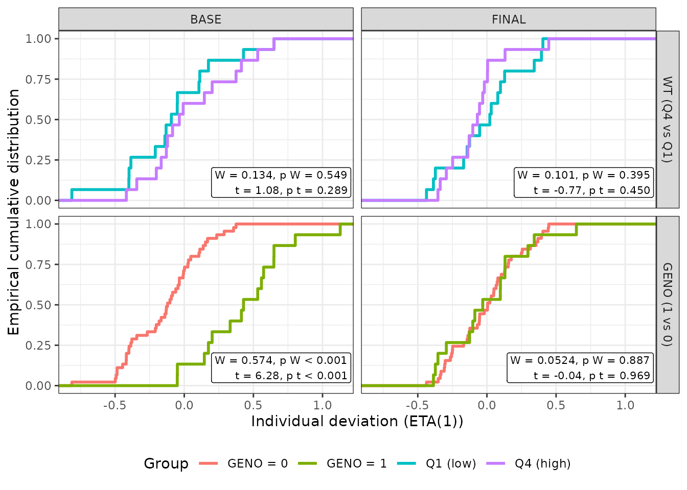
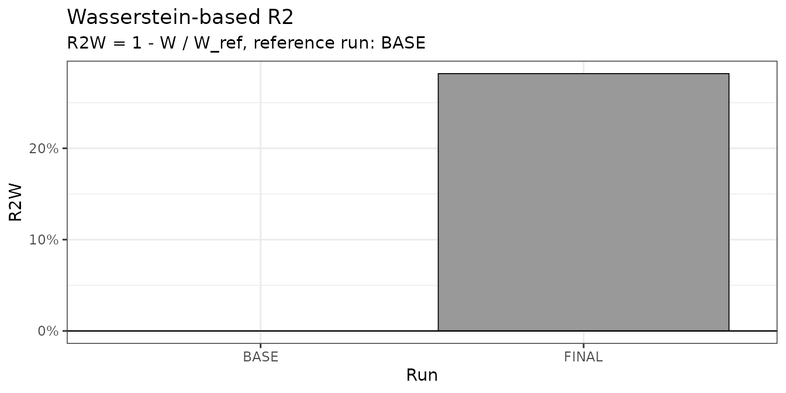

# Covariate assessment with the Wasserstein distance

[`nm_wasserstein()`](https://nskoch.github.io/nmpilot/reference/nm_wasserstein.md)
implements the method of Simon, Hulot and von Fabeck (Front Pharmacol
2026, <doi:10.3389/fphar.2026.1804989>). For one or several runs, it
compares the distribution of the individual deviations (ETA) between
groups of subjects defined by a covariate:

- the distance between the two distributions is the 1-Wasserstein
  distance W (the area between their empirical cumulative
  distributions); its p-value comes from a permutation test, and a
  t-test is given for reference;
- a categorical covariate compares its levels; a continuous covariate
  compares its 4th and 1st quartiles (`continuous = "extremes"`,
  default) or every pair of quartiles (`continuous = "pairwise"`,
  Bonferroni-adjusted);
- a Wasserstein-based R2, `R2W = 1 - W/W_ref`, where W is the distance
  of the ETA distribution to 0, measures how much of the variability
  left in the reference run is explained by a model; the ETA shrinkage
  is reported with it.

## Example

The example project of the package contains a BASE model without
covariate and a FINAL model with body weight and genotype on CL
(simulated data, see
[`vignette("nmpilot")`](https://nskoch.github.io/nmpilot/articles/nmpilot.md)).
The covariates are read from the data set named in `$DATA`; the ETA on
CL is found from the model code.

``` r

library(nmpilot)
ex <- system.file("extdata", "example", package = "nmpilot")
w <- nm_wasserstein(
  runs       = c(BASE = file.path(ex, "run1.reg"), FINAL = file.path(ex, "run2.reg")),
  covariates = c("WT", "GENO"),
  eta        = "CL",
  n_perm     = 2000
)
w
#> Wasserstein covariate assessment (2000 permutations)
#> ETA: ETA(1) | reference run: BASE
#> 
#>    run covariate        type comparison n_1 n_0      W     p_W t_stat     p_t
#>   BASE        WT  continuous   Q4 vs Q1  15  15 0.1340   0.549   1.08   0.289
#>   BASE      GENO categorical     1 vs 0  15  45 0.5740 < 0.001   6.28 < 0.001
#>  FINAL        WT  continuous   Q4 vs Q1  15  15 0.1010   0.395  -0.77   0.450
#>  FINAL      GENO categorical     1 vs 0  15  45 0.0524   0.887  -0.04   0.969
#> 
#> Wasserstein-based R2 (R2W = 1 - W/W_ref, W = distance of the ETA to 0):
#>    run    eta  n W_to_zero   R2W  omega shrinkage_pct
#>   BASE ETA(1) 60     0.285 0.000 0.1430           1.7
#>  FINAL ETA(1) 60     0.205 0.282 0.0683           3.5
```

In the BASE model the distribution of the CL deviations differs strongly
between genotypes; in the FINAL model, where genotype is in the model,
the two distributions overlap.

``` r

plot(w)
```



``` r

plot(w, type = "r2w")
```



## Several pairs of quartiles

``` r

wp <- nm_wasserstein(c(BASE = file.path(ex, "run1.reg")), covariates = "WT",
                     eta = "CL", n_perm = 2000, continuous = "pairwise")
wp$tests[, c("comparison", "W", "p_W", "p_W_adj")]
#>   comparison         W       p_W   p_W_adj
#> 1   Q2 vs Q1 0.1080039 0.7576212 1.0000000
#> 2   Q3 vs Q1 0.2162271 0.2528736 1.0000000
#> 3   Q4 vs Q1 0.1339521 0.5597201 1.0000000
#> 4   Q3 vs Q2 0.2380052 0.1489255 0.8935532
#> 5   Q4 vs Q2 0.1601287 0.2763618 1.0000000
#> 6   Q4 vs Q3 0.1092407 0.8515742 1.0000000
```

## Inputs

`runs` takes run directories of any name (`run1.reg`, `run1.nm7`,
`run1/`) or a run prefix (`"C:/study/run1"` for `run1.ext`, `run1.phi`
and `run1.ctl` in the same folder). Each run needs its `.phi`
(individual ETAs), `.ext` (OMEGA, for the shrinkage) and control stream.
The covariates can also be given directly with `data`, a data.frame or a
CSV file with one row per subject.
